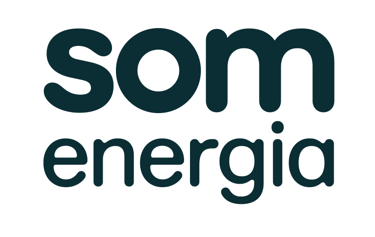
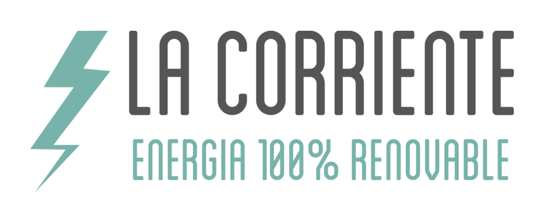

El próximo jueves 26 a las 19:00 en el local de AVIB (calle Estefanita, 58) se presentarán las comercializadoras eléctricas Som Energía y La Corriente. 

[Som Energía](https://www.somenergia.coop) es una cooperativa de consumo de energía verde sin ánimo de lucro que nació en Girona en 2010. Hoy la forman decenas de miles de personas socias de todo el Estado. Comercializa electricidad 100 % renovable y promueve sus propios proyectos de generación, financiados con la participación de sus socias. Funciona de forma democrática: cada persona socia tiene un voto en las decisiones de la cooperativa. Así contribuye a un modelo energético renovable y en manos de la ciudadanía.

[La Corriente](https://lacorrientecoop.es) es una cooperativa madrileña de consumo de energía renovable sin ánimo de lucro, que nació en 2017 en el seno del Mercado Social de Madrid. Comercializa electricidad 100 % renovable y trabaja con cercanía en los barrios: acompaña a comunidades energéticas, como la Comunidad Energética Vallekana, y lucha contra la pobreza energética. Como cooperativa, sus decisiones se toman de forma democrática entre sus personas socias, con el objetivo de una energía más justa, sostenible y al servicio de las personas.

Esta charla está dirigida especialmente a las socias de Brillaverde, aunque está abierta al público en general, por lo que te animamos a venir y, de paso, conocer nuestro proyecto si aún no lo conoces.