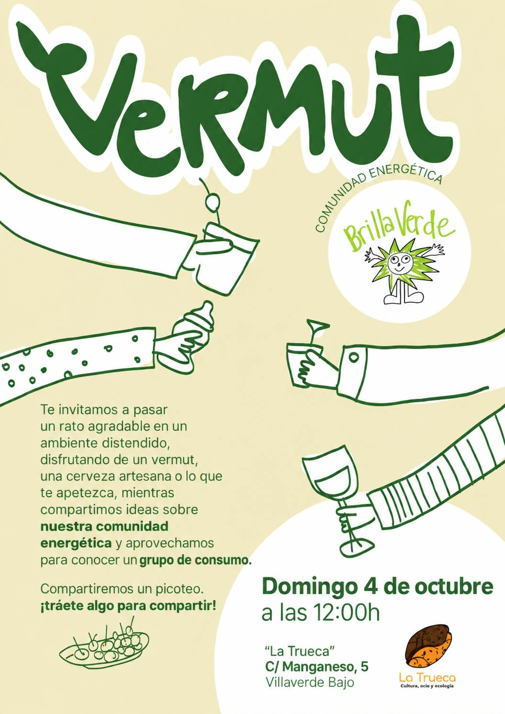

Tras el éxito del primer vermut de Brillaverde, el próximo **domingo 4 de octubre a las 12:00** volveremos a compartir otro vermut en la Trueca (calle Manganeso, 5).

El objetivo de este encuentro, al igual que el anterior, es darnos a conocer en el barrio, resolver dudas a las personas interesadas en formar parte de la cooperativa energética, compartir ideas e inquietudes entre las personas que ya formamos parte de la cooperativa y conocernos un poco mejor.

Te invitamos a pasar un rato agradable en un ambiente distendido, disfrutando de un vermut, una cerveza artesana o lo que te apetezca, mientras compartimos ideas sobre nuestra comunidad energética y aprovechamos para conocer un grupo de consumo.

Compartiremos un picoteo. ¡Tráete algo para compartir!

